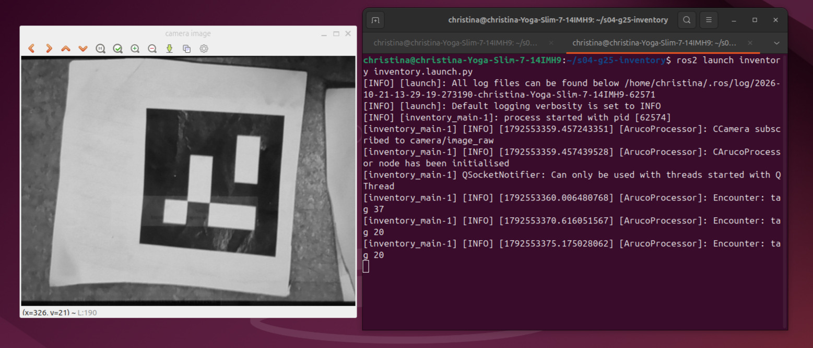
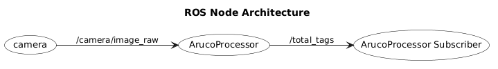
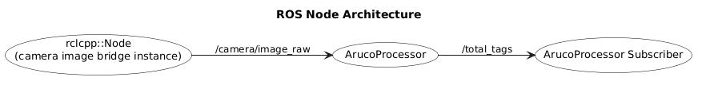
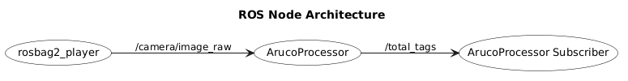
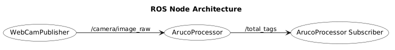
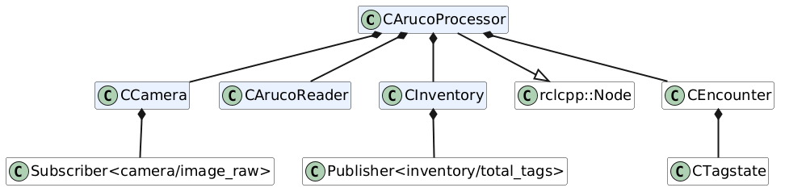
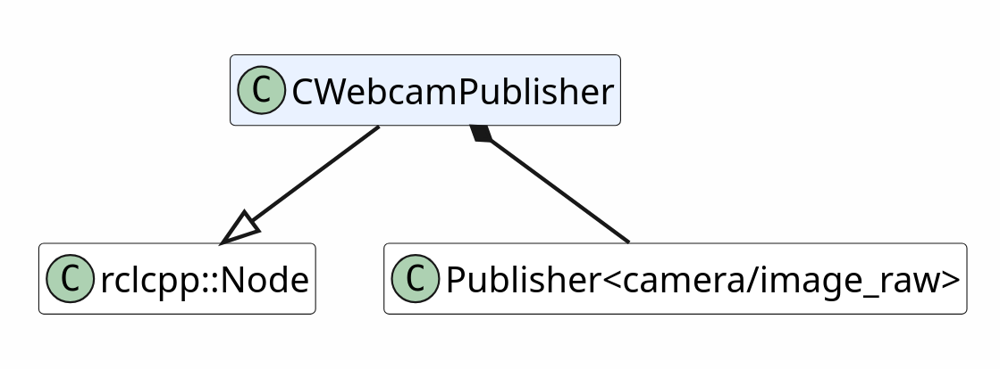
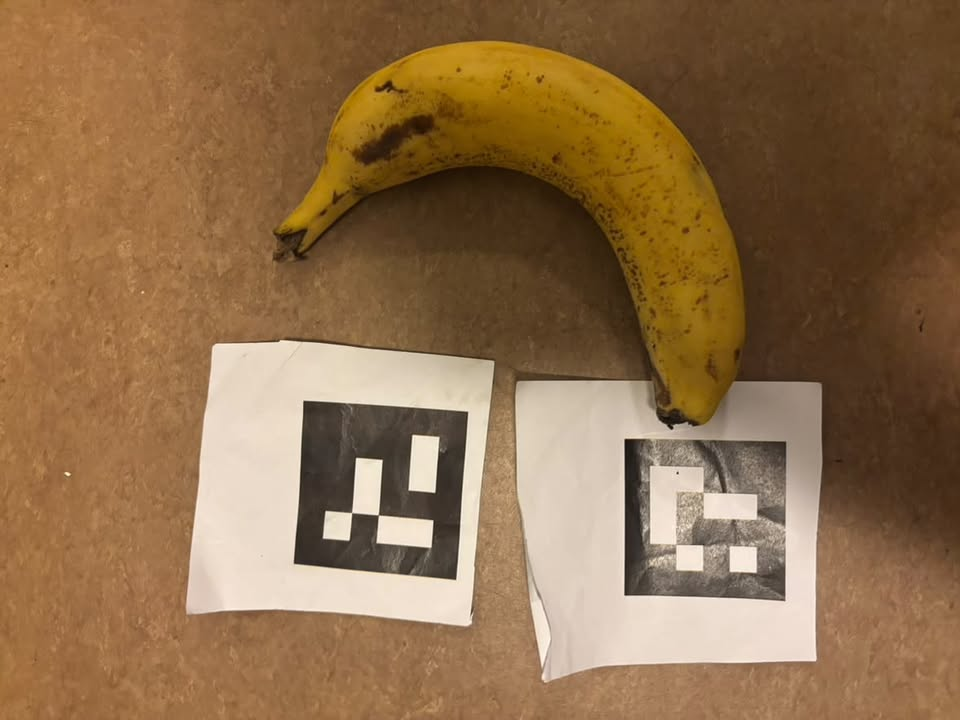
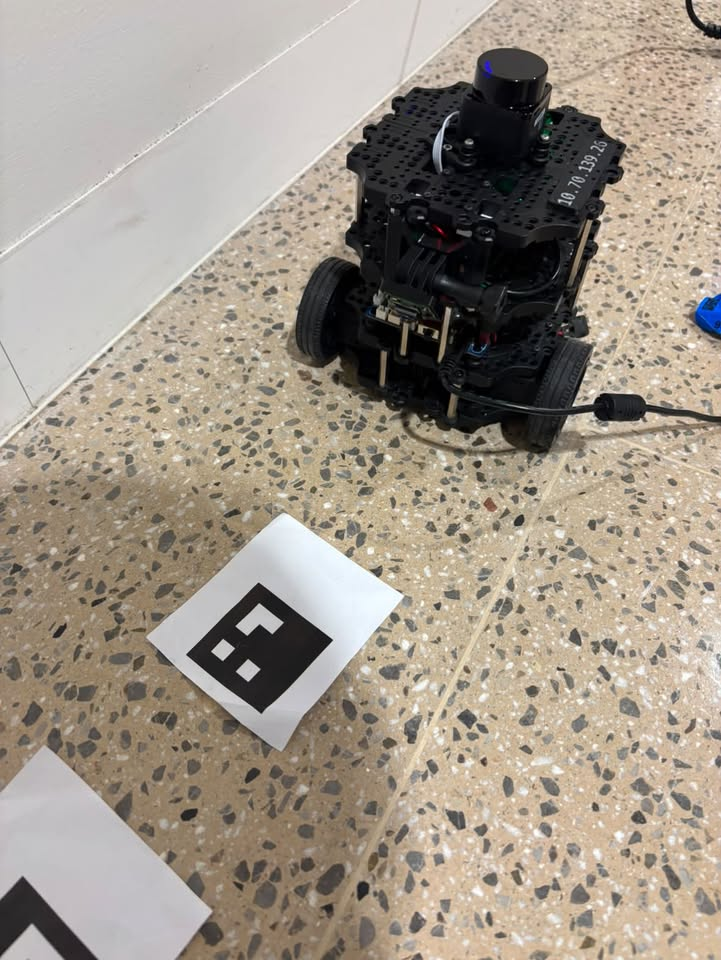
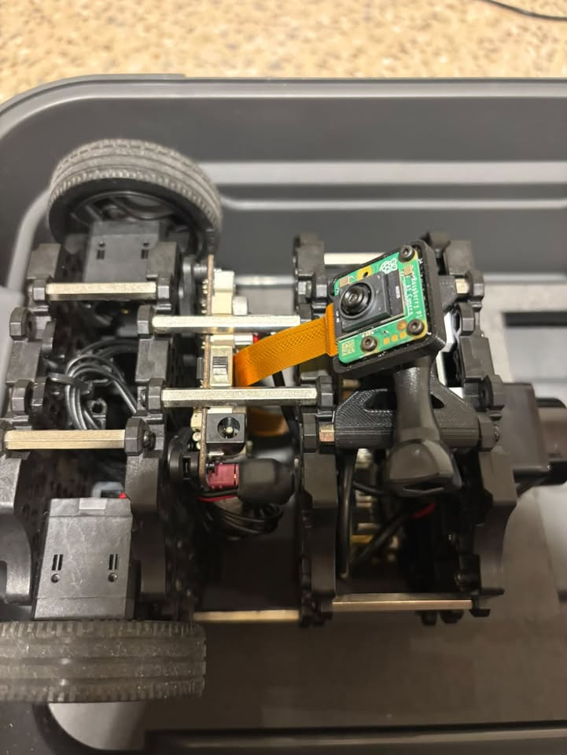

# Introduction and Purpose
In this task, the package is required to receive real life/simulation image topic(s) and process them to check for the presence of aruco markers. The program is then expected to report the ID number if one is encountered, where driving over the same tag later is counted as a new encounter. This package uses image processing functions from the Open CV library, which is mostly used to identify the aruco identification numbers given any image.
 The purpose of this package is to identify aruco markers through the published topic camera/image_raw. The camera/image_raw topic could be published from a gazebo world, the physical turtlebot3, a colcon test with bag data which you have previously recorded, or this package's webcam node. 

Before you try to use this package, please make sure you have Ubuntu 24.04, Gazebo Harmonic (if you are using gazebo as a publisher for camera/image_raw), and ROS2 jazzy. If you are using gazebo simulation or the real robot then you will also need the TurtleBot3 package. 

# How to build, run, and test it
To run the program, you will need  two nodes. The first is the inventory node which will subscribe to 'camera/image_raw' and publish 'total_tags'. The second is the physical turtlebot's 'cam' node which will publish 
'camera/image_raw'. Other options for testing and simulation are also outlined below. Your options are: gazebo simulations, using your laptop's webcam, or playing a test bag from recorded material. The package is built 
using colcon build and can be tested with colcon test.

The workspace sits in the project's src file on the first level, so make sure you build inventory from inside there. Below is the file structure for clarification.
## File structure

```text
s04-g25-inventory/
├── .gitignore               # keeps build output out of git
├── README.md                # this file
├── diagrams/                # UML class diagrams (.puml sources and .png renders), node design diagram
├
made by inventory_test
└── src/                     # ROS 2 package root: build with colcon from here
    ├── CMakeLists.txt       # build rules, executables and the launch test
    ├── package.xml          # package name, version and dependencies
    ├── bags/                # short rosbags used by the integration test
    ├── include/             # C++ headers
    │   ├── CArucoProcessor.hpp
    │   ├── CArucoReader.hpp
    │   ├── CCamera.hpp
    │   ├── CEncounter.hpp
    │   ├── CInventory.hpp
    │   ├── CTestMaker.hpp
    │   ├── CWebcamPublisher.hpp
    │   └── CTagState.hpp
    ├── launch/              # launch files (inventory.launch.py)
    ├── markers/                 # printable ArUco marker images (DICT_4X4_50), 
    ├── models/              # Gazebo models, e.g. ArUco marker panels
    ├── src/                 # C++ sources for the three executables
    │   ├── main.cpp                 # inventory_main
    │   ├── webcam_main.cpp          # webcam_publisher
    │   └── ...                      # one .cpp per class, plus the marker generator
    ├── test/                # launch_testing integration tests (run with colcon test)
    └── worlds/              # Gazebo worlds used for testing in simulation
```

| Folder | Contents |
|---|---|
| `diagrams/` | Documentation only. Not used by the build. |
| `markers/` | Marker PNGs to print, with the white border included. |
| `src/` | Everything colcon needs to build, run and test the package. |

Build output (`build/`, `install/`, `log/`) is created when you run `colcon build` and is not committed.

# 0. Clone the repository or download the code

~~~
git clone https://github.sydney.edu.au/mtrx3760-26/s04-g25-inventory.git
cd s04-g25-inventory/src
~~~

# 1. Run the inventory node
The inventory node subscribes to camera/image_raw, processes the image and detects aruco markers and then publishes 'total_tags'. It will also show a window which outputs the current frame, making a video out of the subscribed camera images, which is very useful for debugging. Don't forget to rebuild after any change, including launch, world and test files. 

First, open a new terminal and cd into 's04-g25-inventory/src'. Then, run the following code to source and build.

```bash
source /opt/ros/jazzy/setup.bash
colcon build --packages-select inventory
source install/setup.bash
ros2 launch inventory inventory.launch.py
```
The defaults work for most cases, but you can override them at launch:

```bash
ros2 launch inventory inventory.launch.py absence_timeout_s:=2.0 min_consecutive_frames:=3
ros2 launch inventory inventory.launch.py image_topic:=/my_camera/image_raw
```

| Launch argument | Default | What it does |
|---|---|---|
| `image_topic` | `/camera/image_raw` | Camera topic the node subscribes to |
| `absence_timeout_s` | `1.0` | Seconds a tag must be out of view before it can count as a new encounter |
| `min_consecutive_frames` | `1` | Frames in a row a tag must be seen before it counts |


You should see that the camera is subscribed to camera/image_raw, and that the node was initialised, as below.
~~~
[inventory_main-1] [INFO] [1792552517.737480939] [ArucoProcessor]: CCamera subscribed to camera/image_raw
[inventory_main-1] [INFO] [1792552517.737648541] [ArucoProcessor]: CArucoProcessor node has been initialised
~~~

# 2. Run a camera node
The requirement of this task is that the physical robot's camera node will publish the camera image. However, it is also useful to have other options to simulate the robot's own camera. Below we do have the way to run the camera node on the robot, as well as 3 other options: playing a prerecorded rosbag, using your laptop's webcam, or using Gazebo.

## Using the physical turtlebot
First, open a new terminal and SSH into the robot. What you run will depend on your preferred networking status. Remember to replace **NN** with your turtlebot's number, and that the password is 'turtlebot'. You have 3 options:
~~~
ssh ubuntu@10.70.139.NN # In the lab on kirbybots
~~~

~~~
ssh ubuntu@10.42.0.1 # Using AP mode
~~~

~~~
ssh ubuntu@TB3-NN.local # Using your hotspot or another wifi network
~~~

Next, start the robot's camera node,
~~~
cam
~~~

At this point, your camera should be publishing and the inventory node should be subscribing! You should see a window which shows the robot's camera output and if an aruco marker comes onto the screen the inventory terminal should echo the current encounter, as below. In this example, tag 20, tag 49, and tag 20 were shown to the camera. Below is an example image of what it might look like if an aruco marker is shown to the camera.
~~~
[inventory_main-1] [INFO] [1792552692.584921460] [ArucoProcessor]: Encounter: tag 20
[inventory_main-1] [INFO] [1792552699.806020182] [ArucoProcessor]: Encounter: tag 49
[inventory_main-1] [INFO] [1792552709.836167214] [ArucoProcessor]: Encounter: tag 20
~~~

.

Next, you can run the wall follower program of your choosing, just don't forget to bringup the motors and odom by SSHing to the robot in a new terminal and running,
~~~
bringup
~~~
Lastly, run your wallfollower code in a new terminal.

## Using your laptop's webcam

There is also a webcam node built into this package, which is able to access your own laptop's webcam in place of the robot's camera to be used for testing. Remember to cd into 's04-g25-inventory/src'. Then, run the following code,

``` bash
ros2 run inventory webcam_publisher --ros-args -p device_index:=0 -p width:=640 -p height:=480 -p fps:=30.0
```
Here, the width and height is specified just in case you want to adjust the image later, as well as fps 30 is a good mix of speed and accuracy.

## Using gazebo simulations

World: `worlds/inventory_loop.world`, a closed 3.0 x 2.25 m loop corridor with six floor tiles, so a
right-wall follower laps it and re-meets every tag. Spawn at x=0.4, y=0.15, yaw=0.
Expected inventory: `[34, 4, 20, 49, 23, 5, 34, 4, 20, 49, 23, 5, ...]`.

Remember to cd into 's04-g25-inventory/src'. Then, double check that the aruco marker png files are visible.

```bash
export GZ_SIM_RESOURCE_PATH="$GZ_SIM_RESOURCE_PATH:$(ros2 pkg prefix inventory)/share/inventory/models"
ls "$(ros2 pkg prefix inventory)/share/inventory/models"  # must list aruco_marker_* folders
```

Now load the world only, to check that it loads:

```bash
gz sim -r "$(ros2 pkg prefix inventory)/share/inventory/worlds/inventory_loop.world"
```
If it hangs: `pkill -9 -f "gz sim"; pkill -9 -f gzserver; pkill -9 -f gzclient`

Now, run your wall follower code. This is not included in this README.

You can then do run checks: tiles visible on the floor (white squares means the models were not found);
tags readable in the camera image (a mirrored tag is not detected; flip the PNG);
tags detected at all (the sim camera is a 182 degree fisheye, 320x240, no downward tilt, which may
defeat detection).

## Using a prerecorded rosbag
We have several prerecorded bags of the camera/image_raw topic. Remember to cd into 's04-g25-inventory/src', and then cd into 'bags'. Play them using the following code,
```bash
ros2 bag play robot_duplicates1 #Expected output: 34, 49, 20, 34, 4
~~~
ros2 bag play webcam_test #Expected output: 20, 49, 4, 34
```
Playing these will allow you to manually test whether or not the output is what you expect. There are also launch tests built into the package which makes testing automatic.

# 3. Test CEncounter logic without colcon test using its own executable

Running this will manually test the logic in CEncounter with a separate executable.

```bash
g++ -std=c++20 -Wall -Wextra -Wpedantic -Iinclude src/CEncounter.cpp src/CTagState.cpp src/test.cpp -o encounter_test && ./encounter_test
```

Expect 11 `PASS` lines and exit code 0 to indicate that all of the tests have been passed.

# 4. Test with colcon test

We have multiple tests included using colcon test. The following code will test all of the tests which are outlined in the table below. Remember to cd into 's04-g25-inventory/src'.

```bash
colcon test --packages-select inventory --event-handlers console_direct+
colcon test-result --verbose
```

| Test | What it checks |
|---|---|
| `encounter_test` | The unit test above, through CTest |
| `webcam_test` | Launches the node, plays bag `webcam_test`, expects `[20, 49, 4, 34]` |
| `robot_duplicates1_test` | Same with bag `robot_duplicates1`, expects `[34, 49, 20, 34, 4]` |
| lint | flake8, pep257, cppcheck, xmllint (style only) |

A failed bag test prints `Final inventory was [...]`. Full log: `log/latest_test/inventory/stdout_stderr.log`.

If you only want to run one test at a time use the following code. Replace 'robot_duplicates1' with 'webcam_test' to run the other bag test.

```bash
colcon test --packages-select inventory --ctest-args -R robot_duplicates1 --event-handlers console_direct+
```

# 5. Watch the output
Here are several debugging and observation lines to run in a new terminal so that you can double check the behaviour of the program.

```bash
ros2 topic echo /inventory/encounter          # one Int32 per new encounter
ros2 topic echo /inventory/total_tags --once --qos-durability transient_local --qos-reliability reliable
                                              # whole ordered list so far; works any time, even after a bag ends
ros2 topic hz /camera/image_raw               # is the camera publishing
ros2 node info /ArucoProcessor                # subscriptions, publishers, parameters
```

# 6. How to record a bag
Record your own bag for testing with the following instructions. In the first terminal in 'src/s04-g25-inventory',

```bash
ros2 run inventory webcam_publisher --ros-args -p width:=320 -p height:=240 -p fps:=10.0   # Pick your publisher: either webcam, robot, or Gazebo
```
In a second terminal,
```
cd src/s04-g25-inventory/src/bags
ros2 bag record /camera/image_raw -o my_bag --compression-mode file --compression-format zstd
```
Replace 'my_bag' with whatever name you like. Press CTRL+C to stop recording and then go to the bags folder and your new bag will be there.

For a re-encounter bag: show tag A, move it out of view for longer than `absence_timeout_s`, show A again.

# 7. Make tag images

`inventory_test` writes `markers/marker<ID>.png`. The ID is hardcoded to 6 in `CTestMaker`, and the
`markers/` folder must exist where you run it. Remember to cd into 's04-g25-inventory/src'.

```bash
ros2 run inventory inventory_test
```

# 8. Quick fixes

| Symptom | Fix |
|---|---|
| `Package 'inventory' not found` | `source install/setup.bash` in this terminal, or the build failed |
| Build error on `cv::aruco` | OpenCV 4.7 or newer. Jazzy's 4.6 works |
| `unable to find uri model://aruco_marker_*` | `GZ_SIM_RESOURCE_PATH` not set in this terminal, or package not rebuilt so `share/inventory/models` is missing |
| Test: `Node never published on inventory/total_tags` | Node crashed or got no images; read `stdout_stderr.log` |
| Test: wrong list | Thresholds do not suit the bag; reproduce by hand and tune |
| Other groups' topics visible | `export ROS_AUTOMATIC_DISCOVERY_RANGE=LOCALHOST` or set your own `ROS_DOMAIN_ID` |

# How the camera tells apart two separate encounters
If the same marker appears twice in one frame, it is counted once. Once a tag has been counted, it can only be counted again after it has been out of view for longer than ```absence_timeout_s```. The default is 1 second (```kDefaultAbsenceTimeoutS``` in CArucoProcessor.hpp). If the tag reappears sooner, it is still the same encounter. This logic is in CEncounter.cpp and CTagState.cpp.

min_consecutive_frames (default 1) is how many frames in a row a tag must be seen before it counts. Raise it if OpenCV keeps picking up one-frame false detections, though a higher value also means a fast pass over a tag may be missed. Both settings can be passed as launch arguments, for example ```ros2 launch inventory inventory.launch.py absence_timeout_s:=2.0```.

# Interface

## Topics for ArucoProcessor
Notes: 
- the Quality of Service 'Best effort' means that the publisher only sends out the data once, and doesn't wait for a response. Reliable means that the message is confirmed to have been sent through middleware (rmw_cyclonedds_cpp) and will be resent until it is received.
- The volatility refers to whether or not a message will get resent if there is a new subscriber to the message.
- The depth refers to how many messages are kept as more come in.


| Direction | Topic | Message type | QoS | Description |
|---|---|---|---|---|
| Subscribes | `/camera/image_raw` | `sensor_msgs/msg/Image` | Best effort, volatile, depth 5 (`SensorDataQoS`) | Camera frames. Converted to greyscale before tag detection. |
| Publishes | `/inventory/total_tags` | `std_msgs/msg/Int32MultiArray` | Reliable, volatile, depth 1 | Every tag ID found so far, in the order first seen. Published each time the list changes. |

`Int32MultiArray.data` holds the IDs. The `layout` field is not set, so use the length of `data` for the count. Remap either topic with standard ROS remapping, for example `--ros-args -r camera/image_raw:=/my_camera/image_raw`.

## ArucoProcessor Parameters

| Parameter | Type | Default | Description |
|---|---|---|---|
| `absence_timeout_s` | double | `1.0` | Seconds a tag must be out of view before it can be counted as a new encounter. If it reappears sooner, it is the same encounter. |
| `min_consecutive_frames` | int | `1` | Frames in a row a tag must be seen before it counts. Raise it to ignore one-frame false detections, at the risk of missing a fast pass over a tag. |

Both can be set as launch arguments (see section 1). The tag dictionary (`DICT_4X4_50`) and the 10 ms processing period are fixed in the code.


## ArucoProcessor behaviour at the edges

| Situation | Behaviour |
|---|---|
| No camera image received yet | Nothing is published and the inventory stays empty. The node prints nothing and tries again on the next 10 ms tick. |
| No tag in the frame | Nothing is published and the inventory is unchanged. |
| Tag already in the inventory | If a certain amount of time passes then the tag is readded after the timeout ends. |
| Several new tags in one frame | All are added, in the order the detector returns them, and one message is published. |
| Marker from a different dictionary, or an ID above 49 | Not detected. Only `DICT_4X4_50` markers (IDs 0 to 49) are recognised. |
| Tag too small, blurred or without a white border | May not be detected. Detection needs a clear white margin around the marker and clear quality.|
| Subscriber connects after tags were found | It receives the current inventory immediately. |
| Same frame processed twice | Harmless. Frames are processed on a 10 ms timer using the latest image, so a frame can be handled more than once, or skipped if a newer one arrives first. |
| Node output on the terminal | The full list is printed once as `total tags are: [...]` when the node shuts down (Ctrl+C). |

## Optional test tool: `webcam_publisher`

Publishes a laptop webcam with the topic camera/image_raw so that the node can be tried without a robot.

## webcam_publisher Parameters

| Parameter | Type | Default | Description |
|---|---|---|---|
| `device_index` | int | `0` | Which `/dev/video` device to open. |
| `topic` | string | `camera/image_raw` | Topic to publish on. |
| `width` | int | `640` | Requested frame width in pixels. |
| `height` | int | `480` | Requested frame height in pixels. |
| `fps` | double | `30.0` | Requested publish rate. |
| `frame_id` | string | `camera_rgb_optical_frame` | `frame_id` in the image header. |

## webcam_publisher Behaviour at the edges.
If the camera cannot be opened, the node logs a fatal error and exits with code 1.

# ROS Node Diagrams

The inventory node can interact with any node which can publish camera/image_raw. Shown below are four of the nodes which can be used in real life and simulation: the camera from the robot, 'camera', the gazebo simulation, the webcam from your laptop which you can launch in the package, 'webcam', and from the rosbag, 'rosbagplayer'. These are shown below.

.

.

.

.


# UML class diagrams
Each node from above has its own UML class diagrams. The two nodes involved in this package are shown below.

## Aruco Processor UML diagram


.


## Webcam UML diagram

.


# Tile size

The tiles which we are using with the real life measure to be 6cm x 6cm. They are ArUco markers from the DICT_4X4_50 dictionary. A larger size up to about 15cm is acceptable, but any smaller than 6cm may cause reading errors. Any tile which you want to make can be made using CTestMaker.cpp. The marker created from this file has a white border so that it is more easily detected by the inventory node.

.
Tile size (banana for scale)

Run the tag maker with the following code,
~~~
colcon build --packages-select inventory
source install/setup.bash
ros2 run inventory inventory_test
~~~

# Camera tilt

The camera tilt expected on the real robot is roughly 45 degrees from horizontal. If the camera is too low it was found that it would miss tags as it would drive over them too quick. If the camera is too high then it will not see the tags at all. 45 degrees is ideal but 20- 60 degrees from the downward position is ideal.

.

.

The images above show the ideal camera tilt.
