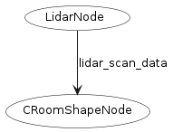
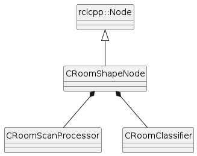

# Room Shape — MTRX3760 Project 2, Phase 1

**ROS 2 Jazzy · C++17 · TurtleBot3 Burger · Gazebo Sim**
**University of Sydney — Section 02, Group 12**

## 1. Purpose and scope

`roomshape` is a self-contained ROS 2 C++ package that **classifies the current enclosed room using LiDAR scans** and publishes the detected room type for other ROS 2 nodes to consume.

The classifier processes `sensor_msgs/msg/LaserScan` measurements, estimates the room's bounding dimensions and compares them with five documented room definitions. The room type is **not obtained from a Gazebo world name, SDF filename or launch argument**.

This package **does not drive the robot**. For the full Phase 1 task (follow a wall while identifying the room), use a separate wall-following controller alongside this package. The classifier itself can also run without a physical robot using the included ROS bag, or in one of the supplied Gazebo worlds.

## 2. Supported rooms and physical dimensions

All dimensions below are **internal free-space dimensions measured between the inward-facing wall surfaces**, not the outside dimensions of the enclosure. The simulated walls are 0.05 m thick and 0.50 m high. A cardboard test enclosure should reproduce the listed internal shape and dimensions, with walls that are visible at the robot's LiDAR height.

| Published label | Internal room geometry | Supplied Gazebo world |
| --- | --- | --- |
| `SMALL_SQUARE` | Square, **1.00 m × 1.00 m** | `worlds/small_square.sdf` |
| `LARGE_SQUARE` | Square, **1.50 m × 1.50 m** | `worlds/large_square.sdf` |
| `RECTANGLE` | Rectangle, **0.50 m × 1.00 m** | `worlds/rectangle.sdf` |
| `HALLWAY` | Enclosed hallway, **0.45 m × 1.45 m** | `worlds/hallway.sdf` |
| `EQUILATERAL_TRIANGLE` | Equilateral triangle, **1.00 m per internal side** (three 60° interior corners) | `worlds/equilateral_triangle.sdf` |

The triangle is approximated for classification by minimum-bounding dimensions of approximately **0.866 m × 1.000 m**. The four-sided rooms have four straight walls and closed corners; the triangular room has three straight walls and closed corners. The hallway is a **closed, elongated enclosure**, rather than an open-ended passage.

The package uses a per-side dimension tolerance of **±0.18 m** by default. This is a **classification threshold**, not permission to change the physical room dimensions arbitrarily. Real-world performance depends on LiDAR coverage, obstructions, wall returns and robot position; the five supplied simulation rooms are the tested reference geometries.

## 3. ROS 2 interface

### 3.1 Topics

| Direction | Default topic | Message type | QoS and behaviour |
| --- | --- | --- | --- |
| Input | `/scan` | `sensor_msgs/msg/LaserScan` | `rclcpp::SensorDataQoS()`; receives LiDAR range measurements |
| Output | `/room_shape/type` | `std_msgs/msg/String` | **RELIABLE**, **TRANSIENT_LOCAL**, **KEEP_LAST(1)**; publishes a stable supported room label |

The output is **event-driven, not periodic**:

1. A candidate room must be detected in **three consecutive scans** by default.
2. The first stable classification is published.
3. The same stable label is **not republished** for every subsequent scan.
4. If the stable label later changes, the new label is published.
5. A newly connected compatible subscriber can receive the **last published label** through `TRANSIENT_LOCAL` durability.

A subscriber expecting the retained result should use compatible QoS:

```bash
ros2 topic echo /room_shape/type \
  --qos-reliability reliable \
  --qos-durability transient_local
```

### 3.2 ROS parameters

These values are declared when the node starts. Invalid non-positive values are rejected by the implementation and replaced with the stated defaults.

| Parameter | Type | Default | Description |
| --- | --- | --- | --- |
| `match_tolerance` | `double` | `0.18` | Maximum absolute error (metres) for **each** estimated side compared with a room definition |
| `required_stable_scans` | `int` | `3` | Number of consecutive matching classifications required to publish |
| `minimum_valid_points` | `int` | `80` | Minimum number of valid LiDAR returns required to estimate dimensions |

Both `gazebo.launch.py` and `real_robot.launch.py` expose the classification parameters and topic remappings. The Gazebo entry starts simulation; the real-robot entry starts only the classifier and requires an already running robot driver, external simulator or bag:

| Launch argument | Default | Purpose |
| --- | --- | --- |
| `world` | `small_square.sdf` | Gazebo entry only: relative path under `roomshape/worlds/` or an absolute path; empty values are rejected |
| `use_sim_time` | Gazebo: `true`; real robot: `false` | Boolean override; set `true` in the real-robot entry when using an existing simulator |
| `gui` | `true` | Show Gazebo GUI; `false` runs a headless server when a world is supplied |
| `x_pose`, `y_pose` | `0.0`, `0.0` | Simulated robot spawn position in metres |
| `scan_topic` | `/scan` | Remap the classifier's LiDAR input |
| `result_topic` | `/room_shape/type` | Remap the classification output |

For example:

```bash
ros2 launch roomshape real_robot.launch.py \
  scan_topic:=/scan \
  result_topic:=/room_shape/type \
  match_tolerance:=0.18 \
  required_stable_scans:=3 \
  minimum_valid_points:=80
```

**Boundary cases and output semantics**

| Situation | Implemented behaviour |
| --- | --- |
| No `/scan` messages received | Node stays running and waits; it does not publish a new room label |
| `NaN`, infinity or out-of-range LiDAR return | That point is discarded |
| Fewer than `minimum_valid_points` valid returns | Scan is considered invalid; no new classification is published |
| Dimensions do not match any supported room | Candidate stability counter resets; no `UNKNOWN` or empty string is published |
| Supported label appears for fewer than `required_stable_scans` consecutive scans | No new label is published yet |
| Same stable classification continues | No repeated publication of the same label |
| A previously published label is followed by invalid or unrecognised scans | **The last published label remains retained**; consumers must not interpret it as proof of a fresh, valid scan |

The package currently has **no explicit freshness/timeout topic** and does not output a confidence score. A consuming system that needs freshness guarantees should monitor the incoming scans or introduce its own validity policy.

## 4. Requirements and build

Required environment: **Ubuntu with ROS 2 Jazzy**, `colcon`, a C++17 compiler and the dependencies in `package.xml` (`rclcpp`, `sensor_msgs`, `std_msgs`, launch tooling and testing dependencies). Gazebo demonstration additionally requires **Gazebo Sim via ROS 2**, TurtleBot3 Gazebo/description packages, and the ROS–Gazebo bridge used by the TurtleBot3 launch files. Rosbag playback requires `ros2 bag` and the SQLite storage plugin.

Choose **one** build layout below. In later commands, "build root" means the
directory where you ran `colcon build`; its `install/setup.bash` is the one to
source. Start builds in a fresh terminal with ROS 2 Jazzy sourced, rather than
an old or deleted project overlay.

### 4.1 Existing checkout: build inside the package

For the current Project 2 folder layout:

```bash
cd ~/Documents/2026/MTRX_3760/Project_2/s02-g12-roomshape
source /opt/ros/jazzy/setup.bash
colcon build --base-paths . --packages-select roomshape \
  --symlink-install --cmake-args -DBUILD_TESTING=ON
source install/setup.bash
```

Replace the `cd` path if your checkout is elsewhere. Here the package directory
is also the build root. There is no `simulation/` subdirectory to use as a
`--base-paths` argument. `--symlink-install` is a development convenience;
`-DBUILD_TESTING=ON` explicitly enables the registered tests.

### 4.2 Alternative: a conventional ROS 2 workspace

For a new checkout, `~/roomshape_ws` is only an example:

```bash
mkdir -p ~/roomshape_ws/src
cd ~/roomshape_ws/src

# Clone into the ROS package directory if not already present.
git clone git@github.sydney.edu.au:mtrx3760-26/s02-g12-roomshape.git roomshape

cd ~/roomshape_ws
source /opt/ros/jazzy/setup.bash
colcon build --base-paths src --packages-select roomshape \
  --symlink-install --cmake-args -DBUILD_TESTING=ON
source install/setup.bash
```

If you already have a copy of this repository, **do not clone a second copy**
just to run it. For this alternative layout the build root is `~/roomshape_ws`.
In **every new terminal**, change to your chosen build root, then source
`/opt/ros/jazzy/setup.bash` and `install/setup.bash`. Do not mix the package-local
install with a separate `Project_2/install` or example-workspace install.

## 5. Use the included Rosbag (no robot or Gazebo required)

The repository includes a short ROS 2 Jazzy / SQLite bag at `bags/small_square_demo/` containing **40 messages on `/scan`** over approximately **8.0 s**. Its expected classification is `SMALL_SQUARE`.

**Terminal 1 — start the classifier** (from your chosen build root):

```bash
source /opt/ros/jazzy/setup.bash
source install/setup.bash
ros2 launch roomshape real_robot.launch.py
```

**Terminal 2 — monitor the output** (from the same build root):

```bash
source /opt/ros/jazzy/setup.bash
source install/setup.bash
ros2 topic echo /room_shape/type \
  --qos-reliability reliable \
  --qos-durability transient_local
```

**Terminal 3 — play the installed bag** (from the same build root):

```bash
source /opt/ros/jazzy/setup.bash
source install/setup.bash
ros2 bag play "$(ros2 pkg prefix roomshape)/share/roomshape/bags/small_square_demo"
```

Expected output in Terminal 2:

```yaml
data: SMALL_SQUARE
---
```

The bag finishes quickly and returns control to the terminal. The node normally publishes this label only once, so start the listener **before** playback or use the `TRANSIENT_LOCAL` QoS shown above. If playback occurs before the ROS graph has discovered the subscriber, replay the bag.

## 6. Gazebo simulation (five supplied worlds)

There are two launch files. `gazebo.launch.py` starts **Gazebo Sim, a TurtleBot3 Burger robot, the required simulation components/bridge, and the Room Shape node**, defaulting to `small_square.sdf`. `real_robot.launch.py` starts only the classifier, without simulation or hardware drivers. Do not run more than one world launch at the same time.

In a terminal with the package built and sourced:

```bash
export TURTLEBOT3_MODEL=burger
ros2 launch roomshape gazebo.launch.py world:=small_square.sdf
```

Select a different `.sdf` world using the same launch file:

| Launch command | Expected classification |
| --- | --- |
| `ros2 launch roomshape gazebo.launch.py world:=small_square.sdf` | `SMALL_SQUARE` |
| `ros2 launch roomshape gazebo.launch.py world:=large_square.sdf` | `LARGE_SQUARE` |
| `ros2 launch roomshape gazebo.launch.py world:=rectangle.sdf` | `RECTANGLE` |
| `ros2 launch roomshape gazebo.launch.py world:=hallway.sdf` | `HALLWAY` |
| `ros2 launch roomshape gazebo.launch.py world:=equilateral_triangle.sdf` | `EQUILATERAL_TRIANGLE` |

For example, start the triangle world:

```bash
ros2 launch roomshape gazebo.launch.py world:=equilateral_triangle.sdf
```

`world` takes a Gazebo world filename, including its extension (for example `small_square.sdf`), not a navigation map YAML. Absolute paths such as `world:=/absolute/path/room.sdf` are also supported. A missing file causes launch to fail before starting processes. For an external world, ensure its Gazebo plugins and model resources support the robot, spawning and LiDAR, avoid duplicate robot/bridge instances, and choose a clear spawn position with `x_pose` and `y_pose`.

Add `gui:=false` for headless simulation. Stop the active simulation with **Ctrl+C** and wait for its processes to exit before launching another room.

To connect to an existing simulator, use the node-only entry with simulation time:

```bash
ros2 launch roomshape real_robot.launch.py use_sim_time:=true
```

For a real robot, first start its TurtleBot3 bringup/driver stack, then run `ros2 launch roomshape real_robot.launch.py`. This entry defaults to wall time and starts neither a simulator nor hardware drivers. It can also process ordinary bag playback. Supply `/scan` from the robot driver or bag. Topic remapping affects only the classifier, not the simulator's bridge.

The former unified `roomshape.launch.py` and older per-room launch files have been replaced by `gazebo.launch.py` and `real_robot.launch.py`. Rebuild and source the workspace; a fresh install directory avoids stale launch files left by older builds. Choose only one Gazebo launch when combining both packages.

In another sourced terminal, inspect the stable classification using the output Topic command in Section 3.1. To confirm which world was loaded, look for the `World [...] initialized` log; to check classification, look for `Stable room type: <LABEL>`.

### Optional: drive while classifying

The Room Shape node **does not publish `/cmd_vel`**. If a separate wall-follower package is installed, launch its **controller-only** file against the existing Gazebo instance; do **not** launch a second Gazebo world. Both nodes consume `/scan`; the separate controller publishes `/cmd_vel` to the simulator's bridge.

For the Group 12 Wall Follower package, after sourcing its own workspace alongside the Room Shape workspace:

```bash
ros2 launch wall_follower real_robot.launch.py use_sim_time:=true
# In another sourced terminal:
ros2 run wall_follower wallctl start
# When finished:
ros2 run wall_follower wallctl stop
```

This is an **optional integration demonstration** and is not a dependency of the standalone Room Shape node or its robot-free test. A retained `LARGE_SQUARE` output after moving does not, by itself, demonstrate classification accuracy at every robot pose.

## 7. Tests and validation

From the same build root used in Section 4, after a successful build with
`BUILD_TESTING=ON`. No robot, running Gazebo or manually started classifier is
needed; the integration test starts its own node and bag player.

```bash
source /opt/ros/jazzy/setup.bash
source install/setup.bash
colcon test --packages-select roomshape --event-handlers console_direct+
colcon test-result --verbose
```

Check the final result for **0 errors and 0 failures**; `Finished` alone is not
a test result, and skipped checks have not been verified.

The assignment's robot-free bag integration test is retained. The optional
classifier unit test and launch-configuration test have been removed.
Rebuild before testing so CMake regenerates the test list.

After removal (20 October 2026), a fresh build and the retained bag integration
test passed. Combined checks for both packages reported 0 errors, 0 failures
and 11 skipped cppcheck checks. No Gazebo or physical-robot run was performed
for this test-suite change.

The package provides:

Earlier two-entry verification, before optional-test removal (20 October 2026):
clean build and the robot/node-only rosbag integration test passed.
A headless `gazebo.launch.py` smoke test received live scans and reported
`SMALL_SQUARE`, then shut down on SIGINT. This was a stationary small-square
check, not a five-world rerun or a moving-robot accuracy test. Python lint
checks target `launch/`, `scripts/` and `test/`, excluding old generated installs.

- **`test/test_roomshape_launch.py`** — a ROS 2 **`launch_testing` integration test** that starts the real C++ Room Shape node through `real_robot.launch.py` with bag data instead of hardware, plays `bags/small_square_demo` and asserts that `/room_shape/type` reports `SMALL_SQUARE`. Its test is registered in CMake with ROS 2's **isolated test runner** and requires no physical TurtleBot3 or running Gazebo.
- ROS 2 style, markup and build-file lint tests registered through `ament_lint_auto`.

Historical test counts in `VALIDATION_REPORT.md` describe the earlier test
suite, not the reduced suite. The removed tests no longer check classifier
edge cases or launch argument combinations automatically. The cppcheck wrapper
may skip analysis depending on the installed tool version.

`scripts/test_all_worlds.sh` is an **optional developer tool**, not a file
required by the assignment or a replacement for the `launch_testing` test
above. Its Gazebo checks are not automatically executed by `colcon test`.

For the **package-local build in Section 4.1**, run from the package directory:

```bash
# Optional: starts Gazebo in each of the five supplied rooms.
bash scripts/test_all_worlds.sh "$(pwd)"
```

For the **workspace layout in Section 4.2**, run from `~/roomshape_ws`:

```bash
bash src/roomshape/scripts/test_all_worlds.sh "$(pwd)"
```

Always pass the build root as the shell script's first argument; it must contain
`install/setup.bash`. Do not rely on the script's automatic directory detection.
Close other simulations before running it. Allow approximately 45 seconds per
world plus shutdown/startup time; the intended final line is
`Result: 5/5 Gazebo worlds passed.`. This scripted check is **separate from** the
robot-free `colcon test` requirement.

**Earlier verification, before launch consolidation (20 October 2026):** a clean-workspace build succeeded; CTest reported **8/8 tests passed** and `colcon test-result` reported **0 failures and 0 errors** (with some skipped checks); the included small-square bag passed the integration test; and all five supplied Gazebo worlds produced their expected classifications in individual, stationary-robot trials. `cppcheck` was reported as passed by the test wrapper but was not actually run due to the local `cppcheck` version. These observations do not establish accuracy for arbitrary rooms or every pose during movement.

## 8. Design diagrams

Both diagrams below are **manually designed from this package's source-level architecture**, not exported from `rqt_graph`. The simplified UML contains **class and struct names only**, without member variables or member functions.

### 8.1 ROS Node Design Diagram



The `CRoomShapeNode` subscribes to `/scan` to classify the room and publishes the result to `room_shape/type`. Other nodes can subscribe to this topic to use the room type for further tasks.

### 8.2 Simplified UML Class Diagram



The UML class diagram shows that `CRoomShapeNode` inherits from `rclcpp::Node` and owns `CRoomScanProcessor` and `CRoomClassifier` for scan processing and room classification.

## 9. Package structure

```text
roomshape/
├── CMakeLists.txt
├── package.xml
├── README.md
├── include/roomshape/              # C++ classes and room data types
├── src/                            # C++ node, scan processor and classifier
├── launch/                         # gazebo.launch.py and real_robot.launch.py
├── worlds/                         # Five standalone Gazebo SDF worlds
├── bags/small_square_demo/         # LiDAR rosbag + metadata
├── test/                           # Isolated rosbag launch_testing test
├── scripts/                        # Optional multi-world Gazebo test script
└── docs/                           # Manually authored design diagrams
```

## 10. Limitations and integration notes

- This is a **dimension-based** classifier: it approximates scan geometry by a minimum-area bounding rectangle over orientations of 0–89° in one-degree steps. The triangle is identified by its **bounding dimensions**, not by a three-edge shape detector.
- The best candidate is the room definition that passes the per-side tolerance and has the smallest combined absolute side error. Multiple different shapes can be ambiguous when their bounding dimensions overlap within tolerance.
- Invalid, missing or unmatched scans do **not** trigger an explicit `UNKNOWN` label or clear the last retained output. Consumers must handle potentially stale classifications themselves.
- The current ROS 2 node does not command motion or offer a start/stop service. A wall-following controller is a separate component.
- For adoption by another team, use **`real_robot.launch.py`** plus your own `/scan` source. This leaves the existing robot or simulator stack untouched.

## 11. Source code and attribution

The implementation is C++17. Submitted C++ headers and source files include the MTRX3760 Project 2 mandatory file header, filename, author attribution and description. Preserve each file's author attribution when making later changes.

The C++ style follows the team's Wall Follower package: class files are named `CRoomShapeNode.h/.cpp`, `CRoomScanProcessor.h/.cpp` and `CRoomClassifier.h/.cpp`; shared room dimensions are declared in `RoomDimensions.h`. Members use an `m` prefix, value/reference parameters use `a`/`ar`, local variables and struct fields use PascalCase, and constants use `k`. Code uses two-space indentation, attached braces and section comments. The room-specific name `CRoomScanProcessor` distinguishes this class from Wall Follower's `CScanProcessor`. All production classes and `RoomDimensions` are grouped in `namespace roomshape` to keep their C++ names separate from other packages; this does not change ROS topic or node namespaces. `Point2D` and `RoomDefinition` are private nested types; constants and processing helpers are class members. `RoomDimensions` remains a shared standalone struct, and the required `main()` entry point remains global. These internal C++ names and header paths changed; ROS node names, topics, parameters and classification behaviour are unchanged.

The automatic `uncrustify` formatting check is disabled in CMake, so building
and testing no longer require a formatter configuration file. Maintain the
team's C++ style when editing. The rosbag integration test and the other enabled
lint checks remain in place.

The university project's final report and code appendix have separate submission rules, including acknowledgement of generative AI use where applicable. This README is the documentation of the **Phase 1 `roomshape` package**, not a substitute for those report components.
