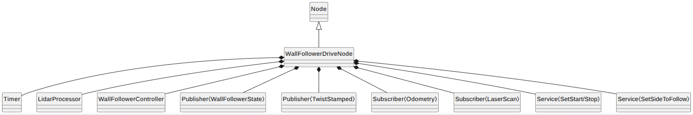
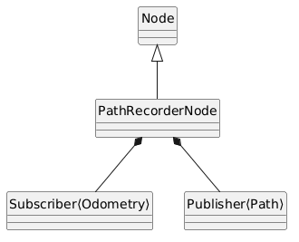
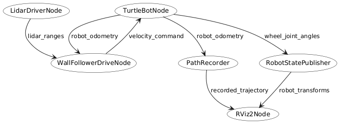

# s02-g03-wallfollower

A modular, robust wall-following package for TurtleBot3 (`burger` and `burger_cam`) developed for ROS 2 Jazzy (MTRX3760 Project 2).

---

## 1. Purpose of the Package

The `wall_follower` package provides autonomous wall-following capabilities for the TurtleBot3 platform. The robot navigates along boundaries (following either the left-hand or right-hand wall) at a configurable clearance distance, automatically detects and rounds outer corners, avoids front obstacles, and smoothly handles deadband tracking to prevent jitter.

Key features:
- **Bi-directional wall following**: Follows the left or right wall as selected by the `follow_left` startup parameter or runtime service.
- **Startable and stoppable at runtime**: Start, stop, or toggle running state dynamically using ROS 2 services (`/wall_follower/start`, `/wall_follower/stop`, `/wall_follower/set_running`).
- **Compact state reporting**: Publishes scan timestamp, state, selected wall side, and scan validity. LiDAR distances and velocity commands are not duplicated in the state message.
- **Fail-safe scan timeouts**: Stops motion when scans are missing or stale and reports `WAITING_FOR_SCAN`.
- **Modular architecture**: Separation of sensor processing (`LidarProcessor`), control logic (`WallFollowerController`), and ROS node management (`WallFollowerDrive`).

---

## 2. How to Build, Test, and Run

### Prerequisites & Dependencies
The workspace targets ROS 2 Jazzy on Ubuntu 24.04 LTS. Install the required ROS 2 dependencies:
```bash
sudo apt update
sudo apt install ros-jazzy-generate-parameter-library
```

From the workspace root, clone the ROBOTIS vendor packages using the included script:
```bash
source /opt/ros/jazzy/setup.bash
bash clone_repo.sh
```

### Building the Package
Build `wall_follower` using `colcon`:
```bash
colcon build --symlink-install --packages-select wall_follower
source install/setup.bash
```
*Note: Always source `install/setup.bash` in each new terminal before launching or inspecting topics.*

### Testing the Package
Test `wall_follower` using `colcon test`:
```bash
colcon test --packages-select wall_follower --event-handlers console_direct+ --ctest-args -R test_test_wall_follower.py --output-on-failure
```

### Running on Physical Hardware
Run on board the TurtleBot3 (`sim_time:=false`):
```bash
ros2 launch wall_follower launch.py sim_time:=false
```
Optional arguments:
- `usb_port`: OpenCR microcontroller serial port (default: `/dev/ttyACM0`).
- `use_camera`: Enable hardware camera stream (default: `false`).

---

## 3. How to Run Without a Robot

### Gazebo Simulation
The package is designed to run in the standard TurtleBot3 Gazebo world (`turtlebot3_gazebo/worlds/turtlebot3_world.world`) without any physical hardware. 

Make sure required dependencies exist in the workspace:
```bash
chmod +x clone_repo.sh
./clone_repo.sh
```
Then run (simulation is default launch mode):
```bash
source install/setup.bash
ros2 launch wall_follower launch.py sim_time:=true
```

Optional spawn pose overrides (the default spawn pose `x=1.0, y=-2.0` places the robot near the perimeter wall):
```bash
ros2 launch wall_follower launch.py sim_time:=true x_pose:=1.0 y_pose:=-2.0 z_pose:=0.1
```

To run RViz visualization alongside simulation or hardware:
```bash
ros2 launch wall_follower rviz.launch.py use_sim_time:=true
```

### Inspecting State
The drive node publishes identical compact state messages on `/wall_follower/state`:
```bash
ros2 topic echo /wall_follower/state
```

### Runtime Control via Services
The wall follower can be started, stopped, and switched between left/right wall following at runtime using ROS 2 services:

```bash
# Stop wall following (pauses robot, commands 0 velocity, sets state to PAUSED)
ros2 service call /wall_follower/stop std_srvs/srv/Trigger

# Start or resume wall following
ros2 service call /wall_follower/start std_srvs/srv/Trigger

# Alternatively, set running state explicitly with SetBool:
ros2 service call /wall_follower/set_running std_srvs/srv/SetBool "{data: false}"  # Pause
ros2 service call /wall_follower/set_running std_srvs/srv/SetBool "{data: true}"   # Run

# Dynamically switch wall following side:
ros2 service call /wall_follower/follow_left std_srvs/srv/SetBool "{data: true}"   # Follow left wall
ros2 service call /wall_follower/follow_left std_srvs/srv/SetBool "{data: false}"  # Follow right wall
```

---

## 4. Full Interface

### 4.1 Subscribed Topics

| Topic | Message Type | QoS | Description |
|---|---|---|---|
| `/scan` | `sensor_msgs/msg/LaserScan` | SensorData (Best Effort, Volatile) | 360° 2D LiDAR range scan data. |
| `/odom` | `nav_msgs/msg/Odometry` | Reliable (KeepLast 10) | Robot odometry pose and twist. |

### 4.2 Published Topics

| Topic | Message Type | QoS | Description |
|---|---|---|---|
| `/cmd_vel` | `geometry_msgs/msg/TwistStamped` | Reliable (KeepLast 10) | Stamped forward linear and angular velocity commands. |
| `/wall_follower/state` | `wall_follower/msg/WallFollowerState` | Reliable (KeepLast 10) | Primary state telemetry topic. |
| `/path` | `nav_msgs/msg/Path` | Reliable (KeepLast 10) | Path history recorded by `path_recorder` node for RViz display. |

### 4.3 Custom Message Definition: `wall_follower/msg/WallFollowerState`

`wall_follower/msg/WallFollowerState` provides the following interface:

```text
# Header copied from the latest scan.
# Timestamp is zero before any scan has arrived.
std_msgs/Header header

uint8 PAUSED=0
uint8 FOLLOWING=1
uint8 WAITING_FOR_SCAN=2
uint8 state

# True when following the wall on the left, false for the right.
# Changed at run time with the wall_follower/follow_left service.
bool follow_left

# True when a scan has arrived within the scan timeout.
bool scan_valid
```

#### Field Specifications:
- `header`: Header copied from the latest received `LaserScan`. Before any scan arrives, timestamp is `0` and `frame_id` is empty.
- `state`:
   - `PAUSED (0)`: The node is paused (either `start_running` parameter is `false`, or stopped at runtime via service).
   - `FOLLOWING (1)`: The node is controlling the robot with a valid, recent scan.
   - `WAITING_FOR_SCAN (2)`: No scan has arrived yet, or the last scan exceeds `scan_timeout`.
- `follow_left`: `true` when configured to follow the left wall; otherwise the right wall is followed.
- `scan_valid`: `true` when a scan has arrived within `scan_timeout` (default 1.0 s); `false` when missing or stale.

LiDAR sectors are held internally in `ScanDistances` as `front`, `front_right`, and `right`. For left-wall following, the drive node selects the corresponding left-side angles and mirrors the controller's angular command. Velocity commands are published separately on `/cmd_vel`.

### 4.4 Parameters

Parameters are defined in `src/wall_follower_params.yaml` and loaded at launch from `config/wall_follower_config.yaml`:

| Parameter | Type | Default | Description |
|---|---|---|---|
| `linear_velocity` | double | `0.10` | Forward speed during normal wall tracking (m/s). |
| `angular_velocity` | double | `0.20` | Positive angular speed used for tracking and front-obstacle turns (rad/s); turn direction is selected by the controller and mirrored for left-wall following. |
| `front_obstacle_distance` | double | `0.30` | Distance ahead below which obstacle avoidance begins (m). |
| `front_stop_distance` | double | `0.25` | Distance ahead at or below which forward drive stops (`linear = 0`) and robot turns in place (m). |
| `wall_lost_distance` | double | `0.90` | Side clearance threshold beyond which the wall is considered lost (triggers corner rounding / recovery) (m). |
| `desired_distance_90` | double | `0.20` | Target clearance distance perpendicular to the wall (m). |
| `desired_distance_45` | double | `0.3536` | Target clearance distance along the 45° diagonal ray (m). |
| `wall_distance_tolerance`| double | `0.07` | Deadband tolerance around desired distance to prevent jitter (m). |
| `turn_speed_factor` | double | `0.50` | Scale factor applied to forward speed while turning. |
| `outer_corner_angular_velocity` | double | `-1.20` | Angular turning rate used when rounding outer corners (rad/s; negated if following left). |
| `outer_corner_linear_velocity` | double | `0.12` | Forward speed maintained while rounding outer corners (m/s). |
| `follow_left` | bool | `false` | Starting wall side (`false` for right wall, `true` for left wall). |
| `scan_timeout` | double | `1.0` | Maximum acceptable time between scans before marking `WAITING_FOR_SCAN` (s). |
| `start_running` | bool | `true` | Whether the node begins running immediately upon receiving valid scans. |

### 4.5 Services

The node provides standard ROS 2 services for runtime operational control:

| Service | Type | Description |
|---|---|---|
| `/wall_follower/start` | `std_srvs/srv/Trigger` | Starts or resumes autonomous wall following. |
| `/wall_follower/stop` | `std_srvs/srv/Trigger` | Halts wall following, zeroes velocity commands on `/cmd_vel`, and transitions state to `PAUSED`. |
| `/wall_follower/set_running` | `std_srvs/srv/SetBool` | Enables (`true`) or pauses (`false`) wall following at runtime. |
| `/wall_follower/follow_left` | `std_srvs/srv/SetBool` | Dynamically switches the tracked wall side (`true`: left wall, `false`: right wall). |

---

## 5. Behaviour at the Edges

The controller evaluates sensor inputs and system states in prioritized stages. The table and sections below define the precise robot behaviour across all edge conditions:

| Edge Case | Detection Condition | Controller Action | Telemetry State (`/wall_follower/state`) |
|---|---|---|---|
| **No scan received yet** | `has_scan_ == false` | Publishes zero velocity to `/cmd_vel` | `state = WAITING_FOR_SCAN`, `scan_valid = false`, header timestamp = 0 |
| **Scan timeout / lost stream** | Elapsed time since scan > `scan_timeout` | Publishes zero velocity to `/cmd_vel` | `state = WAITING_FOR_SCAN`, `scan_valid = false` |
| **Startup disabled** | `start_running == false` | Publishes zero velocity to `/cmd_vel` | `state = PAUSED` |
| **Stopped at runtime** | Stopped via `/wall_follower/stop` or `/wall_follower/set_running` | Publishes zero velocity to `/cmd_vel` | `state = PAUSED` |
| **Front obstacle (emergency stop)** | Front scan distance <= `front_stop_distance` (0.25 m) | Linear = `0.0`, Angular = `angular` | `state = FOLLOWING`, `scan_valid = true` |
| **Front obstacle (turning)** | `front_stop_distance < front distance < front_obstacle_distance` (0.30 m) | Linear = `linear * turn_speed_factor`, Angular = `angular` | `state = FOLLOWING` |
| **No wall detected / Outer corner** | Right distance > `wall_lost_distance` AND front-right distance > corner threshold | Linear = `outer_corner_linear_velocity`, Angular = `outer_corner_angular_velocity` | `state = FOLLOWING` |
| **Too close to wall** | Right or front-right distance < target - tolerance | Slows and steers away from wall | `state = FOLLOWING` |
| **Too far from wall** | Right or front-right distance > target + tolerance | Slows and steers toward wall | `state = FOLLOWING` |
| **Within deadband** | Measured side distances within target tolerance | Drives straight | `state = FOLLOWING` |

### Detailed Edge Dynamics:

1. **No Wall Detected (Open Space / Outer Corner Recovery):**
   - When the robot drives past a corner or is placed in open space, the right-side reading exceeds `wall_lost_distance` (0.90 m) and the front-right reading exceeds the controller's diagonal corner threshold.
   - The robot enters outer corner recovery: it executes a controlled arc toward the tracked side (`outer_corner_angular_velocity = -1.2 rad/s` for right wall, `+1.2 rad/s` for left wall) at `0.12 m/s`.
   - This smoothly curls the robot around convex 90° corners without losing contact or colliding with the wall corner.

2. **Inner Corners & Dead Ends:**
   - As an inner corner is approached, `front_distance` drops below `front_obstacle_distance`.
   - The robot prioritizes front clearance over side tracking: it slows down and steers away from the tracked wall.
   - If `front_distance <= front_stop_distance`, forward motion halts completely and the robot pivots in place until the obstacle clears.

3. **Loss of Sensor Stream (Fail-Safe):**
   - If LiDAR communication drops (e.g., driver crash or network delay exceeding `scan_timeout = 1.0 s`), `scan_valid` is flagged `false`.
   - The node immediately zeroes all velocity output on `/cmd_vel` to prevent runaway collisions.
   - The state reports `WAITING_FOR_SCAN`; sector distances are not fields in the state message.

4. **Bi-directional Symmetry (Left vs Right):**
   - When `follow_left` is true in the parameter file, the drive node selects left-side scan angles for the two side measurements and mirrors the controller's angular command.

---

## 6. Code Architecture and Conventions

- **`WallFollowerDrive`**: Top-level ROS 2 node managing subscriptions, publications, timers, parameters, and compact state telemetry.
- **`ScanDistances`**: Groups the three LiDAR measurements consumed by the controller (`front`, `front_right`, and `right`).
- **`LidarProcessor`**: Pure computation class returning the nearest valid range in a requested angular sector.
- **`WallFollowerController`**: Modular, deterministic controller selecting velocity commands based on front and side clearance.
- **`PathRecorderNode`**: Lightweight odometry subscriber publishing accumulated robot trajectories as `nav_msgs/Path` for visualization.
- **Conventions**: Google C++ ROS style (`PascalCase` classes, `camelCase` functions, trailing `_` for private members), verified via `ament_uncrustify` and `ament_flake8`.


## 7. UML class and ROS2 node diagrams
### Wall Follower UML Class Diagram



### Path Recorder UML Class Diagram



### ROS node diagram



